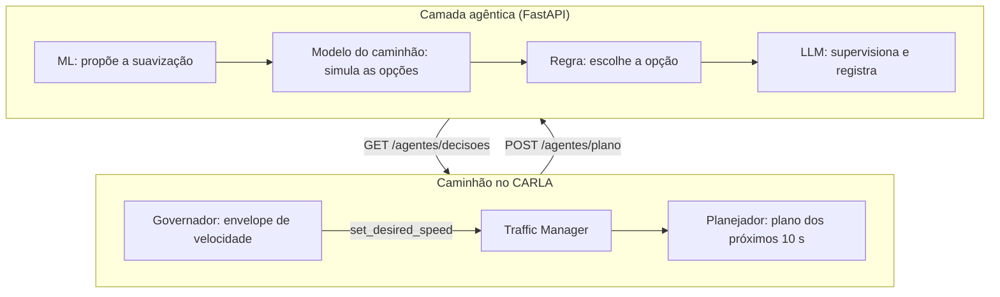
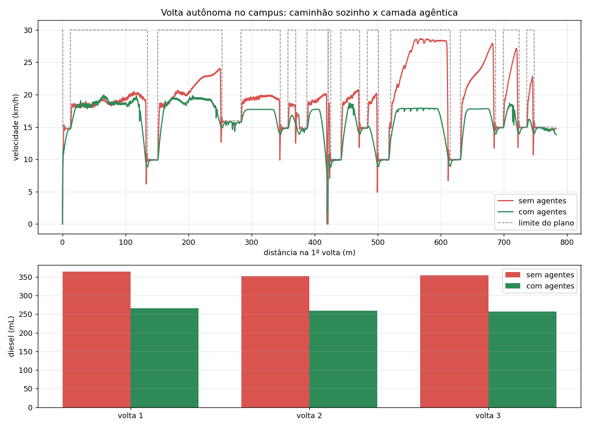

# MOVER _(TCC_MOVER_AGENTES_IA)_

[](https://www.python.org/downloads/)
[](https://carla.org/)
[](https://ollama.com/library/gemma2)
[](https://github.com/RichardLitt/standard-readme)

Gêmeo digital de um caminhão autônomo no CARLA com agentes de IA que suavizam frenagens e arrancadas.

Trabalho de Conclusão de Curso (TCC) do Instituto Mauá de Tecnologia (IMT), 2026.

Um caminhão autônomo, conduzido pelo Traffic Manager (TM) do CARLA, percorre uma volta de 783 m no
campus do IMT. A cada 10 s, ele envia por HTTP o plano do trecho seguinte à camada agêntica, que
antecipa frenagens e arrancadas bruscas e devolve o plano suavizado antes da execução. Um modelo de
aprendizado de máquina (ML) propõe a suavização, um modelo dinâmico do caminhão valida a proposta e
um LLM local (gemma2:2b, via Ollama) supervisiona a decisão e registra a justificativa.

No CARLA, a camada agêntica reduziu o consumo estimado de diesel em 20,5 % e os eventos bruscos em
69,9 %, com 14,0 % a mais de tempo por volta.

## Sumário

- [Instalação](#instalação)
- [Uso](#uso)
- [Arquitetura](#arquitetura)
- [Resultados](#resultados)
- [API](#api)
- [Mantenedores](#mantenedores)
- [Agradecimentos](#agradecimentos)
- [Contribuição](#contribuição)
- [Licença](#licença)

## Instalação

### Dependências

| Dependência | Versão | Observação |
|---|---|---|
| [CARLA](https://carla.org/) | 0.9.16 | instalado em `C:\CARLA_0.9.16`; exige GPU dedicada |
| [Python](https://www.python.org/downloads/) | 3.12 | o cliente `carla` do PyPI existe apenas para o Python 3.10 a 3.12 |
| [Git](https://git-scm.com/) | — | |
| [Ollama](https://ollama.com/) | — | instalado pelo `preparar_ollama.ps1` (passo 4) |

### Windows (PowerShell)

1. Clone o repositório na pasta `PythonAPI` do CARLA:

   ```powershell
   cd C:\CARLA_0.9.16\PythonAPI
   git clone https://github.com/TiagoHiray/TCC_MOVER_AGENTES_IA.git
   cd TCC_MOVER_AGENTES_IA
   ```

2. Crie e ative o ambiente virtual:

   ```powershell
   py -3.12 -m venv env_carla
   Set-ExecutionPolicy -Scope Process -ExecutionPolicy Bypass
   .\env_carla\Scripts\Activate.ps1
   ```

3. Instale as dependências. O modelo de ML versionado foi salvo com o scikit-learn 1.7.2:

   ```powershell
   pip install -r requirements.txt
   pip install scikit-learn==1.7.2
   ```

4. Instale o Ollama e baixe o gemma2:2b. O script também mede a latência do modelo e grava o `.env`:

   ```powershell
   .\scripts\preparar_ollama.ps1
   ```

5. Rode os testes, que não dependem do CARLA nem do LLM:

   ```powershell
   python -m pytest tests -q
   ```

### Linux

```bash
git clone https://github.com/TiagoHiray/TCC_MOVER_AGENTES_IA.git
cd TCC_MOVER_AGENTES_IA
python3.12 -m venv .venv
source .venv/bin/activate
pip install -r requirements.txt
pip install scikit-learn==1.7.2
bash scripts/preparar_ollama.sh
python -m pytest tests -q
```

## Uso

Com o ambiente virtual ativo, os módulos rodam a partir de `src/`.

1. Abra o CARLA em um destes modos:

   ```powershell
   C:\CARLA_0.9.16\CarlaUE4.exe -quality-level=Low -world-port=2000           # com janela
   C:\CARLA_0.9.16\CarlaUE4.exe -RenderOffScreen -quality-level=Low -nosound  # sem janela (benchmark)
   C:\CARLA_0.9.16\CarlaUE4.exe -quality-level=Epic -world-port=2000          # gravação de vídeo
   ```

2. Rode uma volta com agentes. O painel abre em http://127.0.0.1:8000/, com a simulação, os
   gráficos, o log das decisões e o chat:

   ```powershell
   cd src
   python -m mover.autonomo.dirigir
   ```

3. Rode o benchmark: 3 voltas sem agentes e 3 com agentes na mesma execução, com o resultado em
   `data/benchmark/<data>/`:

   ```powershell
   python -m mover.autonomo.benchmark --voltas 3 --provedor ollama
   ```

### CLI

| Tarefa | Comando (em `src/`) |
|---|---|
| Volta com agentes e painel | `python -m mover.autonomo.dirigir` |
| Volta sem painel (coleta de dados) | `python -m mover.autonomo.dirigir --sem-painel` |
| Painel sem o CARLA (simulador substituto) | `python -m mover.autonomo.dirigir --sem-carla --provedor falso` |
| Benchmark | `python -m mover.autonomo.benchmark --voltas 3` |
| Recálculo das métricas de um benchmark salvo | `python -m mover.autonomo.benchmark --recalcular ../data/benchmark/<pasta>` |
| Diagnóstico de uma corrida | `python -m mover.autonomo.diagnostico` |
| Gravação da corrida em MP4 | `python -m mover.autonomo.dirigir --gravar --sair-no-fim` e `python -m mover.video.gravar_video` |
| Servidor dos agentes e do painel | `python -m mover.servidor.rodar_servidor` |
| Treino do modelo de ML | `python -m mover.agentes.suavizador_ml` |
| Plano de missão a partir do mapa | `python -m mover.autonomo.gerar_missao` |
| Análise da última corrida pela camada de logs | `python -m mover.agentes.rodar_agentes` |
| Vídeos e benchmarks da apresentação (um cenário por pergunta, no Town10HD_Opt ou no campus) | `python -m mover.autonomo.apresentacao [--mapa campus] [--seco]` |

Opções do `dirigir` e do `benchmark`:

| Opção | Efeito |
|---|---|
| `--voltas N` | número de voltas (no benchmark, por bateria) |
| `--sem-ml` | agentes apenas com as opções fixas de suavização |
| `--sem-llm` | agentes decidem apenas pela regra |
| `--provedor <nome>` | provedor do LLM: `ollama` (padrão), `openai`, `gemini` ou `falso` |
| `--missao <arquivo>` | outro plano de missão, como `config/missao_cruzeiro20.yaml` |
| `--servidor <url>` | usa um servidor de agentes já em execução |
| `--sem-agentes` | só no `dirigir`: caminhão sem a camada agêntica |
| `--sem-render`, `--sem-espera` | só no `dirigir`: CARLA sem renderização e simulação sem sincronia com o relógio |

No Linux ou no Git Bash, o `scripts/rodar_gemeo.sh` executa as mesmas tarefas a partir da raiz e
confere antes o CARLA e o Ollama:

```bash
./scripts/rodar_gemeo.sh visual                 # volta com agentes e painel
./scripts/rodar_gemeo.sh coleta                 # volta sem painel
./scripts/rodar_gemeo.sh painel                 # painel sem o CARLA
./scripts/rodar_gemeo.sh gravar                 # volta gravada e MP4
./scripts/rodar_gemeo.sh benchmark --voltas 3
```

### Configuração

| Arquivo | Conteúdo |
|---|---|
| `config/autonomo.yaml` | caminhão, governador, opções fixas, decisão (buffer de 10 s, prazo do LLM), modelo de ML, consumo, limiares e benchmark |
| `config/missao.yaml` | rota, zonas e paradas da volta, gerado pelo `gerar_missao` |
| `config/missao_cruzeiro20.yaml` | o mesmo plano com cruzeiro de 20 km/h, usado numa rodada de controle |
| `config/simulacao.yaml` | mapa, conexão com o CARLA, veículo, câmeras e servidor |
| `config/agentes.yaml` | LLM, camada de logs e chat |
| `.env` | `MOVER_LLM_PROVEDOR`, `MOVER_LLM_MODELO` e `OLLAMA_HOST` |

### Saídas

- **Corrida:** `data/autonomo/corridas/<data>_<agentes|bruto>/`, com `telemetria.csv` (20 Hz),
  `decisoes.jsonl`, `resumo.json` e, quando gravada, `video.mp4`.
- **Benchmark:** `data/benchmark/<data>/`, com `resultados.csv`, `resumo.json`, `comparativo.png`,
  as telemetrias das duas baterias e `decisoes.jsonl`.

## Arquitetura



Cada decisão segue seis etapas:

1. **Planejamento** (`autonomo/planejador.py`). No início de cada bloco de 10 s, o caminhão monta o
   plano do bloco seguinte a partir do estado medido: velocidade desejada por zona, perfil previsto
   de velocidade e aceleração, manobras do TM (`get_all_actions`) e decisões bruscas
   (|jerk| ≥ 2,5 m/s³).
2. **Proposta** (`agentes/suavizador_ml.py`). Uma floresta aleatória (200 árvores, treinada com
   2.000 situações simuladas) propõe, para cada zona com decisão brusca, a desaceleração de
   aproximação (0,4 a 1,8 m/s²), a aceleração de retomada (0,3 a 1,2 m/s²) e o teto de
   velocidade.
3. **Validação** (`agentes/decisao.py`). O modelo do caminhão simula o plano original, a proposta do
   ML e quatro opções fixas, e mede o diesel, o tempo e os eventos bruscos de cada uma.
4. **Escolha.** A regra aplica a proposta do ML se ela não tiver mais eventos que a melhor opção fixa
   nem alongar o trecho em mais de 60 %. Caso contrário, aplica a opção fixa de menor custo (diesel
   mais tempo a R$ 30/h).
5. **Supervisão.** O LLM mantém ou troca a opção, sempre entre as já simuladas, e redige o log. Uma
   guarda recusa opções com mais eventos bruscos e textos com números sem respaldo. Se o LLM não
   responder em 6 s, vale a regra.
6. **Execução** (`autonomo/governador.py`). A opção escolhida vira um envelope de velocidade com
   jerk de até 1,6 m/s³, enviado ao TM a cada passo de 50 ms. Sem agentes, o caminhão segue o plano
   em degraus e só começa a frear quando precisa de 4,5 m/s² para atingir a velocidade da zona.

O plano de missão (`config/missao.yaml`) descreve a volta de 783 m, no sentido anti-horário, do mapa
`data/mapas/campus_maua.xodr`: cruzeiro de 30 km/h, 4 lombadas a 10 km/h, 8 faixas de pedestre a
15 km/h, 3 curvas limitadas a 1,6 m/s² de aceleração lateral e uma parada de 4 s no portão.

```text
config/        planos de missão e parâmetros (YAML)
scripts/       preparar_ollama.ps1, preparar_ollama.sh e rodar_gemeo.sh
src/mover/
  autonomo/    caminhão: planejador, governador, consumo, integração com o CARLA, simulador
               substituto, dirigir, benchmark, diagnóstico e plano de missão
  agentes/     camada agêntica: decisão, modelo de ML, supervisor (LLM) e serviço HTTP
  servidor/    aplicação FastAPI e sessão do painel
  interface/   painel web, câmera e chat
  video/       gravação em MP4 e HUD
  simulacao/   leitura do OpenDRIVE e projeção do mapa
  tratamento/  filtros de sinal
tests/         testes automatizados (pytest)
data/          mapas, modelo de ML, corridas e benchmarks
```

## Resultados

Benchmark no CARLA 0.9.16 com o gemma2:2b e o modelo de ML do repositório: 3 voltas sem agentes e 3
com agentes, na mesma execução. Os dados estão em
[`data/benchmark/20261015_004001`](data/benchmark/20261015_004001); duas repetições em 17/10/2026
reproduziram a telemetria bit a bit.

| Por volta | Sem agentes | Com agentes | Variação |
|---|---|---|---|
| Diesel | 336,2 mL | 267,4 mL | **−20,5 %** |
| Eventos bruscos (jerk ≥ 2,5 m/s³) | 24,3 | 7,3 | **−69,9 %** |
| Eventos críticos (jerk ≥ 5 m/s³) | 22,3 | 4,7 | **−79,1 %** |
| Pior desaceleração | −15,1 m/s² | −3,0 m/s² | |
| Energia dissipada nos freios | 586 Wh | 352 Wh | −40,0 % |
| Tempo | 166,2 s | 189,4 s | +14,0 % |

Em 100 voltas, o consumo cai de 33,3 L para 26,5 L de diesel (6,8 L, R$ 40,59 e 18,1 kg de CO2 a
menos) e os eventos bruscos, de 2.304 para 604, com 38,5 min a mais.



### Rodadas de controle

Para isolar a origem do ganho, o benchmark foi repetido em 17/10/2026 com componentes desligados e
com uma linha de base mais lenta. Valores médios por volta; variações em relação à linha de base.

| Configuração | Diesel | Tempo | Eventos bruscos | Críticos | Pasta |
|---|---|---|---|---|---|
| Sem agentes, cruzeiro de 30 km/h (linha de base) | 336,2 mL | 166,2 s | 24,3 | 22,3 | `20261017_134226` |
| Sem agentes, cruzeiro de 20 km/h | 312,3 mL (−7,1 %) | 176,3 s (+6,1 %) | 26,0 | 22,7 | `20261017_135143` |
| Agentes só com as opções fixas (`--sem-ml`) | 271,1 mL (−19,4 %) | 188,8 s (+13,6 %) | 9,3 | 7,3 | `20261017_134949` |
| Agentes só com a regra, sem LLM (`--sem-llm`) | 267,4 mL (−20,5 %) | 189,4 s (+14,0 %) | 7,3 | 4,7 | `20261017_142424` |
| Agentes completos | 267,4 mL (−20,5 %) | 189,4 s (+14,0 %) | 7,3 | 4,7 | `20261017_134226` |
| Agentes completos, missão de 20 km/h | 268,7 mL (−20,1 %) | 188,7 s (+13,6 %) | 8,7 | 5,0 | `20261017_135143` |

### Metodologia

- **Consumo.** O CARLA não simula combustível. O diesel é estimado pelo modelo VT-CPFM (Rakha et
  al.) a partir da velocidade medida e da inclinação da via, para um caminhão de 9 t, com diesel a
  R$ 6,00/L e 2,68 kg de CO2 por litro. O painel e o benchmark usam o mesmo cálculo
  (`autonomo/consumo.py`).
- **Eventos bruscos.** Picos de |jerk| ≥ 2,5 m/s³ (críticos a partir de 5 m/s³) na aceleração
  longitudinal filtrada em 1,5 Hz. Picos a menos de 1 s um do outro contam como um evento.
- **Extrapolação.** 100 voltas = 1ª volta + última volta + 98 × a média das voltas intermediárias.
- **Recálculo.** `python -m mover.autonomo.benchmark --recalcular <pasta>` refaz as métricas a
  partir das telemetrias salvas, sem o CARLA.

### Conclusão

- A camada agêntica reduziu o diesel em 20,5 % e os eventos bruscos em 69,9 %, ao custo de 23 s
  (+14,0 %) por volta.
- O ganho vem do modo de frear e de retomar, não apenas da velocidade menor. Com cruzeiro de
  20 km/h, o caminhão sem agentes economiza 7,1 % e não reduz os eventos bruscos.
- A regra, com o modelo do caminhão, responde pela maior parte da economia: −19,4 % só com as
  opções fixas. O ML acrescenta suavidade, com 36 % menos eventos críticos que as opções fixas.
- O LLM não altera a condução: sem ele, a telemetria é idêntica. Seu papel é supervisionar as
  decisões e explicá-las em linguagem natural.
- O benchmark é reprodutível: as três execuções do cenário principal geraram a mesma telemetria.

## API

O servidor FastAPI escuta em `http://127.0.0.1:8000`, e a especificação OpenAPI interativa fica em
`/docs`. O `dirigir` e o `benchmark` sobem o servidor no próprio processo, a menos que recebam
`--servidor <url>`. Para atender outra máquina, suba o servidor com `--host 0.0.0.0`. As rotas não
têm autenticação.

Em cada corrida, o caminhão abre a sessão dos agentes, envia um plano por bloco de 10 s, busca as
decisões e encerra a sessão no fim. No benchmark, ele envia `"esperar": true`, e a simulação aguarda
cada decisão; assim, o resultado não depende da velocidade da máquina.

**Camada agêntica**

| Método | Rota | Descrição |
|---|---|---|
| `POST` | `/agentes/sessao` | Abre a sessão dos agentes. Corpo: `voltas`, `usar_llm`, `usar_ml`, `provedor`, `modelo` e `comprimento_volta_m`. Retorna `409` se o plano de missão do caminhão diferir do plano do servidor. |
| `POST` | `/agentes/plano` | Recebe o plano dos próximos 10 s e o estado do governador. Retorna `202`; com `"esperar": true`, retorna as decisões na própria resposta. |
| `GET` | `/agentes/decisoes?desde=N` | Mensagens a partir da N-ésima. O campo `etapa` vale `regra` (alteração aplicada na hora), `final` (opção, origem e log, com `trocas` se o LLM mudou a opção), `vazia` (plano sem decisão brusca) ou `erro`. |
| `DELETE` | `/agentes/sessao` | Encerra a sessão dos agentes. |

**Sessão e painel**

| Método | Rota | Descrição |
|---|---|---|
| `GET` | `/saude` | Estado do servidor, da sessão e dos agentes. |
| `POST` | `/sessao` | Abre a sessão do painel (modo, voltas, simulador, provedor e linha de base). |
| `GET` | `/sessao` | Dados da sessão atual. |
| `POST` | `/sessao/telemetria` | Lote de linhas de telemetria (`{"linhas": [...]}`). |
| `POST` | `/sessao/decisoes` | Registra uma decisão da camada agêntica. |
| `GET` | `/sessao/log?desde=N` | Entradas do log a partir da N-ésima. |
| `DELETE` | `/sessao` | Encerra a sessão e retorna o resumo. |
| `GET` | `/benchmark/ultimo` | Resumo do benchmark mais recente. |
| `WS` | `/ws` | Histórico da sessão na conexão e, depois, as mensagens em tempo real. |

**Interface**

| Método | Rota | Descrição |
|---|---|---|
| `GET` | `/` | Painel web. |
| `GET`, `PUT` | `/cena` | Cena 2D: vias, rota, zonas e paradas. |
| `POST` | `/camera` | Quadro JPEG da câmera do CARLA. |
| `GET` | `/camera.jpg`, `/camera.mjpg`, `/camera/info` | Último quadro, transmissão MJPEG e metadados da câmera. |
| `POST` | `/chat` | Pergunta sobre a corrida (`pergunta` e `historico`). |

## Mantenedores

- Daniel Briquez ([@Briqz23](https://github.com/Briqz23))
- Eduardo Santiago ([@EduardoCSantiago](https://github.com/EduardoCSantiago))
- Eduardo Sawada ([@esawada](https://github.com/esawada))
- Gabriel Garcia ([@Garcia-Gabriel](https://github.com/Garcia-Gabriel))
- Tiago Hiray ([@TiagoHiray](https://github.com/TiagoHiray))

## Agradecimentos

- Prof. Rudolf Buhler e Prof. Jhonny Joca, pela orientação.
- Instituto Mauá de Tecnologia, pela VM com GPU usada nas simulações no CARLA.

## Contribuição

Dúvidas e sugestões: abra uma
[issue](https://github.com/TiagoHiray/TCC_MOVER_AGENTES_IA/issues). Alterações entram por pull
request para a `main`, com `python -m pytest tests -q` passando.

## Licença

`UNLICENSED` © 2026, os autores listados em [Mantenedores](#mantenedores). O repositório ainda não
define uma licença de código aberto.
